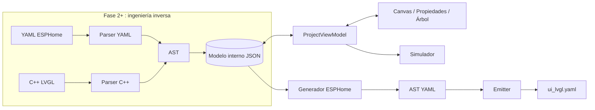
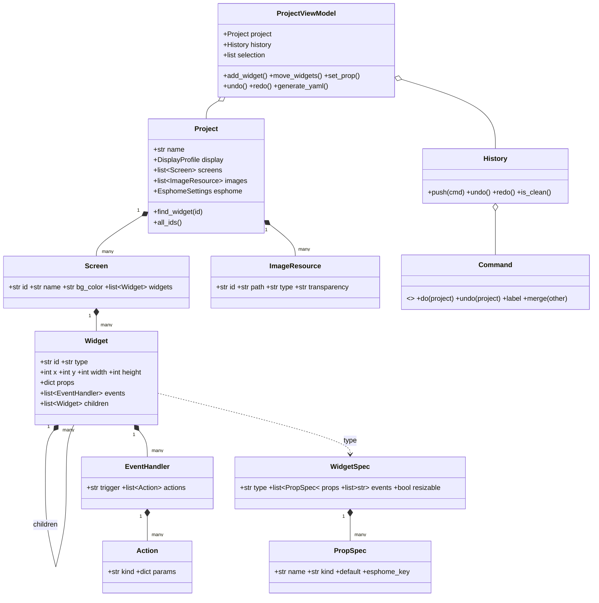
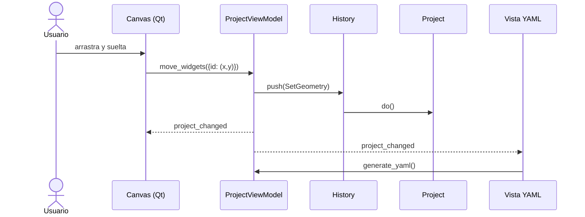

# Fase 0 · 03 — Diseño técnico y arquitectura

## 1. Decisiones

| Decisión | Elección | Motivo |
|---|---|---|
| UI | **Qt6 (PySide6)** | Escritorio nativo, `QGraphicsView` ideal para un canvas tipo Figma, mismo stack que otros proyectos del autor |
| Backend | **Python 3.11+** | Parser YAML maduro, iteración rápida, IA/plug-ins en Python |
| Persistencia de proyecto | JSON (`.olvgl`) | Diffable, legible, migrable por versión de esquema |
| Persistencia de aplicación | **SQLite** (`studio.db`) | Recientes, ajustes; en fases posteriores caché de recursos e índice de componentes |
| Patrones | Clean Architecture + SOLID + **MVVM** | El núcleo no depende de Qt → testeable y reutilizable desde la extensión VS Code (Fase 5) vía CLI/LSP |
| Undo/redo | Patrón Command propio | Historial ilimitado, independiente de Qt, base del Diff/Merge de Fase 3 |

## 2. Capas (Clean Architecture)

```
olvgl/
├── domain/          ← Entidades puras. Sin dependencias.
│   ├── model.py         Project, Screen, Widget, EventHandler, Action, ImageResource
│   ├── catalog.py       Catálogo de widgets LVGL (PropSpec, WidgetSpec)
│   └── yaml_ast.py      AST YAML con posiciones (YMap, YSeq, YScalar, YRaw)
├── application/     ← Casos de uso. Depende sólo de domain.
│   ├── observable.py    Señales sin Qt
│   ├── history.py       Command + History (undo/redo ilimitado)
│   ├── commands.py      Comandos concretos sobre el modelo
│   └── viewmodel.py     ProjectViewModel (MVVM)
├── infrastructure/  ← Adaptadores: ficheros, SQLite, generadores.
│   ├── json_store.py    Guardar/cargar .olvgl, autosave
│   ├── yaml_emitter.py  AST → texto YAML
│   ├── esphome_generator.py  Modelo → AST ESPHome
│   ├── exporter.py      Escribe ui_lvgl.yaml, main.yaml, images/
│   └── settings_db.py   SQLite (recientes, ajustes)
└── presentation/    ← Vistas Qt. Sólo hablan con el ViewModel.
    ├── main_window.py, canvas.py, render.py, palette.py,
    ├── properties.py, tree.py, code_view.py, simulator.py, dialogs.py
```

Regla de dependencias: `presentation → application → domain` e `infrastructure → domain`. El ViewModel recibe los servicios de infraestructura por inyección (funciones `save/load/generate`), cumpliendo la inversión de dependencias.

## 3. Flujo de datos (modelo central)



En Fase 1 está implementada la rama de salida completa (Modelo → AST → texto). El AST es el mismo tipo que producirá el parser de Fase 2, con posiciones (`Span`) para que la sincronización de Fase 3 pueda localizar y reescribir sólo los nodos modificados.

## 4. UML de clases (dominio + aplicación)



## 5. UML de secuencia — mover un widget



## 6. MVVM

- **Model**: `Project` y entidades (dataclasses).
- **ViewModel**: `ProjectViewModel` expone operaciones de alto nivel y señales `project_changed`, `selection_changed`, `screen_changed`, `dirty_changed`, `project_replaced`. Es Python puro → probado con pytest.
- **View**: widgets Qt que escuchan señales y llaman al ViewModel. Nunca modifican el modelo directamente.

## 7. Extensibilidad prevista

- **Catálogo de widgets declarativo** (`catalog.py`): añadir un widget = registrar un `WidgetSpec` + una función de render + reglas del generador. Es el punto de entrada del SDK de plugins (Fase 7).
- **Generadores** detrás de una interfaz `generate(project) -> YNode`: ESPHome YAML hoy; C LVGL en Fase 4; exportadores externos en Fase 7.
- **Acciones** tipadas (`Action.kind`) con escape `raw` para YAML libre: permite cualquier acción ESPHome sin bloquear al usuario.
- **Núcleo sin Qt**: la extensión VS Code (Fase 5) usará el mismo núcleo vía un proceso `olvgl-cli` (JSON-RPC).

## 8. Riesgos

| Riesgo | Mitigación |
|---|---|
| ESPHome cambia su YAML (LVGL 8 → 9) | Generador por versión; tests de forma del YAML |
| Round-trip YAML con comentarios/lambdas | AST propio con `Span`, `YRaw` para nodos no entendidos (Fase 2–3) |
| Fidelidad visual del simulador | Fase 1 aproxima el tema por defecto; Fase 6 valora LVGL real compilado a WASM/SDL |
| Fuentes Montserrat ausentes en el PC | Fallback a Segoe UI/Arial con el mismo tamaño en píxeles |
